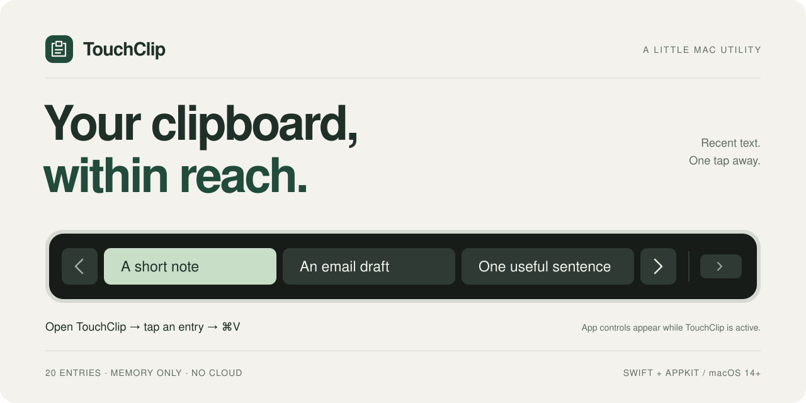
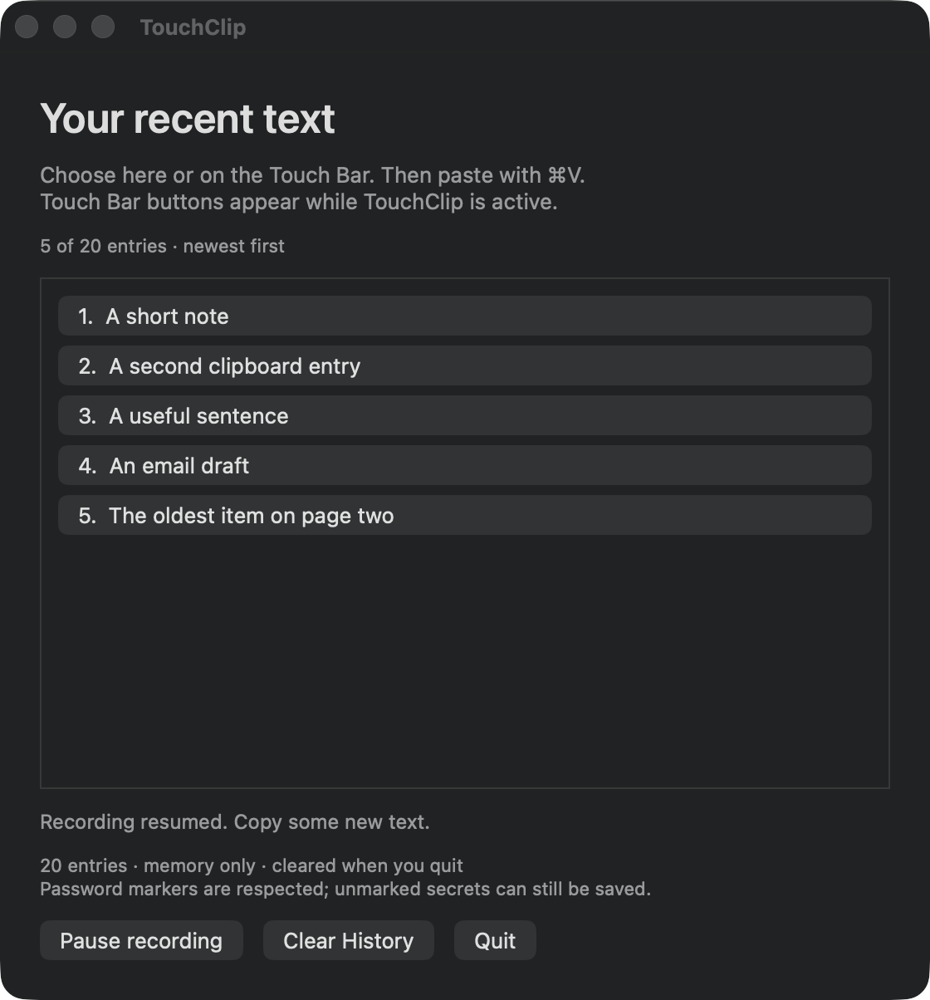

<p align="center">
  
</p>

<p align="center">
  <a href="#get-started">Get started</a> &nbsp;·&nbsp;
  <a href="#how-it-works">How it works</a> &nbsp;·&nbsp;
  <a href="#privacy-by-default">Privacy</a> &nbsp;·&nbsp;
  <a href="docs/TESTING.md">Testing</a>
</p>

<p align="center">
  
  
  
  <a href="LICENSE"></a>
</p>

**TouchClip remembers the text you copy and puts it a tap away.** Open its menu bar icon, choose an entry on your Touch Bar, then press **⌘V** in your app. Small, local, and built with native macOS controls.

> **About the Touch Bar:** Apple's public API shows an app's controls while that app is in front. TouchClip's buttons appear when TouchClip is active; they cannot stay visible across other apps. On Macs without a Touch Bar, use the same history in the window.

## A little history. A lighter workflow.

| | |
| :--- | :--- |
| **20 recent entries** | A small, distinct text history. Recopy an entry to move it to the top. |
| **A tap to restore** | Three Touch Bar entries per page, with arrows for older text. Onscreen buttons work too. |
| **Native from the start** | Swift and AppKit. No package dependencies, browser runtime, or account. |
| **Memory only** | No history database, cloud sync, analytics, or network code. Quit to discard the history. |
| **You stay in control** | Pause recording or clear history. Your current clipboard stays intact. |

<p align="center">
  
  <br>
  <sub>A real native app window, captured with synthetic example text.</sub>
</p>

## Get started

You need **macOS 14+**, **Swift 6+**, and Apple's **Command Line Tools**. Full Xcode and an Apple Developer account are not required. A Touch Bar is optional.

If developer tools are missing, run `xcode-select --install` and finish Apple's installer. If your tools provide an older Swift compiler, update the Command Line Tools or Xcode to a version with Swift 6.

```sh
git clone https://github.com/deadpoods/TouchClip.git
cd TouchClip
zsh install.sh
```

The installer builds for your Mac's CPU, copies the app to `~/Applications/TouchClip.app`, verifies its local signature, and launches it. Quit an existing TouchClip before updating.

To launch later:

```sh
open "$HOME/Applications/TouchClip.app"
```

This project uses a local **ad-hoc signature**. It is source-distributed, not a notarized app download. The build does not disable macOS security protections.

## How it works

1. **Copy** text in any app. Give TouchClip about a second to record it.
2. **Open** the clipboard icon in your menu bar. TouchClip becomes active.
3. **Choose** an entry on the Touch Bar or in the window. Use **‹ / ›** for more entries.
4. **Paste** with **⌘V**. TouchClip asks macOS to return to your previous app. If it stays in front, switch to your destination and paste there.

Closing the window keeps recording running. **Pause recording** stops new captures while keeping saved entries usable. **Clear History** empties the list without changing the system clipboard. **Quit** discards all saved entries. The app does not add a login item or send paste keystrokes for you.

If your Touch Bar shows function keys or the expanded Control Strip, choose **System Settings → Keyboard → Touch Bar Settings → App Controls**. See [Apple's Touch Bar guide](https://support.apple.com/guide/mac-help/mchlc050704e/mac).

## Privacy by default

Your history lives in the app's process memory. TouchClip does not save it to disk, transmit it, or log its contents. macOS manages memory, swap, and the system clipboard independently. Apple's Universal Clipboard setting is independent too; TouchClip adds no synchronization.

- Stores plain text, preserving original Unicode and whitespace for pasting.
- Skips whitespace-only text, images, entries over **64 KiB**, and common concealed, transient, or generated clipboard markers.
- Ignores text on the clipboard at launch and text copied while paused.
- Polls every **0.6 seconds**; very rapid intermediate copies can be missed.

Password managers may mark copied values as concealed. TouchClip respects those markers, but **unmarked secrets can still be recorded**. Pause before copying sensitive text or clear history afterward. Quitting clears TouchClip's history, not the system clipboard.

### Permissions

macOS may ask whether TouchClip can read text copied in another app. Clipboard access is the only permission the app may need. Allow it for TouchClip if you want automatic history; it remains under your control in System Settings. After reversing a denial, copy some new text.

**No Accessibility, Input Monitoring, Screen Recording, Automation, or Full Disk Access is needed.** The optional developer screenshot check is separate from the installed app.

## Build and test

```sh
zsh build.sh    # Compile and locally sign build/TouchClip.app
zsh test.sh     # Run 40 checks using an isolated clipboard
```

Tests cover history limits, deduplication, Unicode, clipboard markers, pause/resume, clear, stale selections, restoration, Touch Bar pagination, and native button actions. They briefly show a test window and leave your real clipboard untouched.

Built and tested on an Intel Touch Bar MacBook Pro running **macOS 26.6.2** with **Swift 6.3.3**. Physical Touch Bar selection followed by pasting was manually confirmed. Other supported macOS versions and Apple silicon are build targets; they have not all been physically tested. See [testing and manual verification](docs/TESTING.md).

<details>
<summary><strong>Project structure</strong></summary>

```text
TouchClip/
├── Sources/
│   ├── Clipboard.swift          # History, capture, filtering, restore
│   ├── App.swift                # Menu bar, window, Touch Bar, app switching
│   └── main.swift               # Native app entry point
├── Tests/main.swift             # Clipboard and AppKit integration checks
├── docs/
│   ├── assets/hero.svg          # Editable repository artwork
│   ├── test-window.png          # Real window with example text
│   └── TESTING.md               # Test guide and verification scope
├── Info.plist
├── build.sh
├── install.sh
├── test.sh
└── TouchClip.sublime-project
```

Open the folder in your preferred editor. A Sublime Text project and build system are included. No generated project files or package downloads are required.

</details>

## Uninstall

Quit TouchClip, then move `~/Applications/TouchClip.app` to the Trash. There are no history files, helpers, services, login items, or cloud accounts to remove. Delete the cloned source folder too if you no longer need it.

## Contributing

Small, focused improvements are welcome. See [CONTRIBUTING.md](CONTRIBUTING.md) for the build, test, and privacy constraints that keep TouchClip simple.

## License

[MIT](LICENSE) · Copyright © 2026 Aaryan Kumar.

<p align="center"><sub>Built with Swift, AppKit, and a little appreciation for the Touch Bar.</sub></p>
